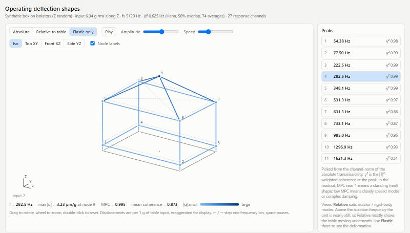
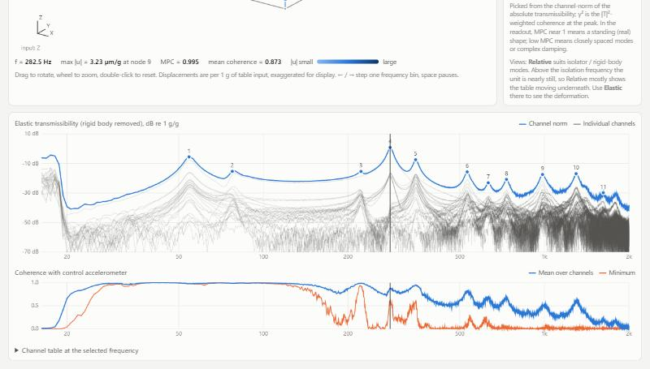

# ods

[](https://github.com/daniel-eunbum-lee/ods/actions/workflows/tests.yml)
[](https://github.com/daniel-eunbum-lee/ods/actions/workflows/matlab.yml)
[](https://github.com/daniel-eunbum-lee/ods/actions/workflows/badges.yml)
[](https://github.com/daniel-eunbum-lee/ods/actions/workflows/matlab.yml)
[](LICENSE)


[](CITATION.cff)

**Operating deflection shapes (ODS) from shaker random-vibration tests.** Point it at your acceleration time histories, sensor geometry and control channel, and see how the unit actually moved at each resonance.



What it does:
- **Transmissibility-based ODS.** It uses the H1 estimate against the control accelerometer, so the shaped test profile drops out and every channel gets magnitude *and* phase, plus coherence to tell you how far to trust it.
- **Three views of the motion:**
  - **Absolute**: what the accelerometers measured.
  - **Relative to table**: for isolator and rigid-body modes.
  - **Elastic**: least-squares 6-DOF rigid-body motion removed, so you see what's deforming even on isolated units.
- **Automatic peak picking**, gated on coherence, plus an MPC readout that flags mixed or complex shapes.
- **A standalone HTML viewer** in one shareable file with no dependencies. It animates the 3D shape, and you can click any frequency on the spectrum.
- **Report-ready outputs**: CSVs (transmissibility, coherence, ASD, per-peak shapes in mm/g) and an NPZ of everything.
- **Validated** against the exact solution of a base-driven cantilever beam: transmissibility within 0.7 % (p99) away from resonances, peaks at the analytic natural frequencies, and shapes matching the exact ODS to MAC > 0.99999. A synthetic box-on-isolators test with known modes adds peaks within 0.4 % and MAC up to 0.999 ([details](docs/method.md#validation)).

## Quick start

Requires Python ≥ 3.11 and [uv](https://docs.astral.sh/uv/).

```powershell
git clone https://github.com/daniel-eunbum-lee/ods.git
```

```powershell
cd ods/python
```

The Python tool lives in `python/`; run the `uv` commands below from that folder.

```powershell
uv sync
```

```powershell
uv run ods synth
```

```powershell
uv run ods run data/synthetic
```

Then open `outputs/ods_viewer.html` in a browser. To look before installing, download [`docs/demo/ods_viewer.html`](docs/demo/ods_viewer.html) and open it locally.

## Your own test

Make one folder per test axis (all channels from one synchronized recording):

```
my_test_z/
  test.json      {"fs": 5120, "units": "g", "excitation_axis": "Z", "time_file": "time.csv"}
  time.csv       time,CTRL,A1Z,A2Z,...
  geometry.csv   node,x,y,z,base
  channels.csv   channel,node,direction,role      (exactly one role=control)
  lines.csv      node_a,node_b                    (optional wireframe)
```

```powershell
uv run ods run my_test_z --out results/my_test_z --title "Unit 3, Z random"
```

Start from the templates in [`examples/template/`](examples/template/).

## MATLAB

A MATLAB version lives in [`matlab/`](matlab/). It reads the same test folders, writes the same outputs and viewer, and needs no toolboxes:

```matlab
run('matlab/toolbox/examples/run_demo.m')             % synthetic demo
res = ods.process('my_test_z', 'results/my_test_z');  % your data (after addpath matlab/toolbox)
```

See [matlab/README.md](matlab/README.md).

## Documentation

| Guide | Contents |
|---|---|
| [How to use](docs/how-to-use.md) | Install, demo, viewer controls, step-by-step setup for your own data, outputs, tuning, troubleshooting |
| [Data format](docs/data-format.md) | Exact spec for every input file |
| [Method](docs/method.md) | H1 and coherence, relative/elastic views, displacement, peak picking, MPC/MAC, validation results, limits |
| [References](docs/references.md) | Sources |



## Project layout

One repository, two implementations of the same tool, tested against the same shared cases:

```
python/                  Python implementation (pyproject.toml, uv.lock)
  src/ods/
    io.py                load test folders (CSV/NPZ + geometry)
    spectra.py           Welch H1 transmissibility, coherence, ASDs
    shapes.py            relative/elastic transforms, displacement, peak picking, MPC, MAC
    pipeline.py          run() and export()
    viewer.py            builds the HTML viewer from viewer_template.html
    synth.py             synthetic box-on-isolators shaker test with known modes
    __main__.py          `ods synth` / `ods run` command line
  tests/                 pytest suite (analytic benchmarks, unit tests, shared-case runner)
matlab/                  MATLAB implementation
  toolbox/               what a MATLAB user installs: +ods package, resources/, examples/
  tests/run_tests.m      MATLAB/Octave suite (unit tests + shared-case runner)
  buildfile.m            tasks for MATLAB's `buildtool`
testdata/                SHARED by both: cases/*.json (specs + tolerances), data/, generate/
examples/                test-folder templates (same files for both languages)
docs/                    guides, screenshots, demo viewer (apply to both languages)
```

See [`testdata/README.md`](testdata/README.md) for the shared-test format.

## Development

```powershell
cd python
uv run pytest
```

MATLAB (or GNU Octave), from the repository root:

```matlab
addpath('matlab/tests'); run_tests
```

GitHub Actions runs the Python suite on every push to main and every pull request (Python 3.11 and 3.14 on Linux, 3.14 on Windows; see [`.github/workflows/tests.yml`](.github/workflows/tests.yml)), and the MATLAB suite on GNU Octave and, where MathWorks' action can set it up, on MATLAB itself ([`.github/workflows/matlab.yml`](.github/workflows/matlab.yml)). Both run the shared cases in `testdata/`.

[PLAN.md](PLAN.md) records the design decisions made during the initial build.

## License

[MIT](LICENSE)
