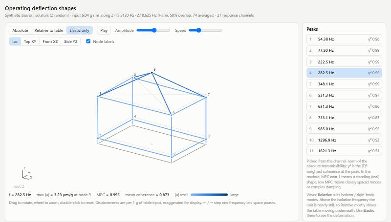
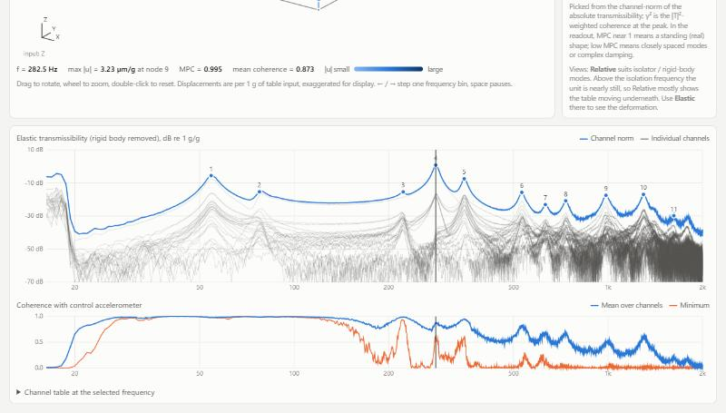

# How to use

This guide covers installing the tool, running the built-in demo, preparing your own shaker data, and reading the results. For the exact file formats see [data-format.md](data-format.md). For the math behind each quantity see [method.md](method.md).

- [1. Install](#1-install)
- [2. Run the demo](#2-run-the-demo)
- [3. Explore the viewer](#3-explore-the-viewer)
- [4. Process your own test](#4-process-your-own-test)
- [5. Read the outputs](#5-read-the-outputs)
- [6. Tuning options](#6-tuning-options)
- [7. Troubleshooting](#7-troubleshooting)

---

> **Using MATLAB?** The same workflow is available in MATLAB, using the same test folders, outputs and viewer. See [matlab/README.md](../matlab/README.md).

## 1. Install

You need Python ≥ 3.11 and [uv](https://docs.astral.sh/uv/).

```powershell
git clone https://github.com/daniel-eunbum-lee/ods.git
```

```powershell
cd ods/python
```

The Python tool lives in `python/`; run every `uv` command in this guide from that folder.

```powershell
uv sync
```

`uv sync` creates `python/.venv/` and installs numpy, scipy and pytest, plus the `ods` command itself. Check the install with:

```powershell
uv run pytest
```

> Upgrading from an older checkout? The environment now lives in `python/.venv`. Delete any old `.venv` in the repository root and select the new interpreter in your editor (in VS Code: *Python: Select Interpreter*).

> No uv? Run `python -m venv .venv` (inside `python/`), activate it, then `pip install -e .` and `pip install pytest`. Everything below then works without the `uv run` prefix.

## 2. Run the demo

The demo generates a synthetic shaker test. The unit is a 3.8 kg box on four corner isolators, with a triaxial accelerometer at each of 9 nodes. It is driven in Z with a 6.06 grms random profile. Because its true modes are known, the demo shows what the tool recovers.

```powershell
uv run ods synth
```

```powershell
uv run ods run data/synthetic
```

Each step takes a few seconds. The second step prints the peaks it found. Since the test is synthetic, it also prints a table comparing each peak with the true mode (see [method.md § Validation](method.md#validation)). Open the viewer:

```powershell
start outputs/ods_viewer.html
```

You can also open [`docs/demo/ods_viewer.html`](demo/ods_viewer.html) without running anything. Download it and open it in a browser; GitHub shows HTML as source.

## 3. Explore the viewer



| Control | What it does |
|---|---|
| **Peaks** list (right) | Jumps to a picked resonance. γ² is the coherence at the peak, weighted toward the channels that move most |
| **Absolute / Relative to table / Elastic only** | Which motion is animated and plotted. See below |
| **Play / Pause**, **Amplitude**, **Speed** | Animation controls. Shapes are scaled automatically to be visible; Amplitude multiplies that |
| **Iso / Top XY / Front XZ / Side YZ** | Preset views. Drag to rotate, wheel to zoom, double-click to reset |
| **Node labels** | Shows node ids |
| Readout under the 3D view | Frequency, the largest displacement and the node it's at (in mm, µm or nm per g of table input), MPC (shape "realness"), mean coherence |
| Spectrum plot | Click anywhere to animate that exact frequency; hover for values. Numbered dots are the picked peaks |
| Coherence plot | Mean and minimum coherence across response channels |
| **Channel table** (collapsed) | Per-channel magnitude, phase, displacement and coherence at the selected frequency. Click a row to highlight that channel in the spectrum |
| Keyboard | ← / → step one frequency bin; space pauses |



**Which view to use:**

- **Absolute**: what the accelerometers saw, including the table's own motion.
- **Relative to table**: motion relative to the fixture. Use it for isolator and rigid-body modes (bounce, rock, sway). Above the isolation frequency an isolated unit is nearly still, so this view mostly shows the table moving under it.
- **Elastic only**: the least-squares rigid-body motion (3 translations + 3 rotations) is removed, leaving deformation only. Use it for panel, bracket and other structural modes.

**MPC** (modal phase collinearity) is close to 1 when every point moves exactly in or out of phase, i.e. a standing wave. Low MPC looks like a travelling wave. It means closely spaced modes are mixing at that frequency, or the damping is non-proportional. See [method.md](method.md#mpc-and-mac).

## 4. Process your own test

### Step 1: Export one run per test axis

All channels, including the control accelerometer, must come from **one synchronized recording**. Phase between channels is the whole point. X, Y and Z runs are separate tests, so process each one separately.

Export the time histories to CSV (one column per channel, optional `time` column first), MAT or NPZ. Units are usually g. If your data is in m/s², set `"units": "m/s^2"`.

### Step 2: Make a test folder

```
my_test_z/
  test.json      sample rate, units, excitation axis
  time.csv       the time histories
  geometry.csv   node coordinates
  channels.csv   which node and direction each channel measures, and which channel is the control
  lines.csv      (optional) wireframe for display
```

You can copy the templates in [`examples/template/`](../examples/template/), or generate a full CSV example to copy from:

```powershell
uv run ods synth --format csv --duration 20 --out data/example_csv
```

### Step 3: Describe the geometry

- **geometry.csv**: one row per node, in any consistent length unit. Add `base=1` rows for points on the shaker table or fixture. They aren't measured, but they're drawn, and in Absolute view they move with the table.
- **channels.csv**: one row per channel name in the time file. `direction` is the sensor's positive axis in **global** coordinates: `+X`, `-Z`, or a vector like `0.707 0.707 0` for a skewed mount. Mark exactly one channel `role=control`.
- **lines.csv**: pairs of nodes to connect in the wireframe. Optional, but without it you only see dots.

Common pitfalls:
- A sensor mounted upside-down is `-Z`, not `+Z`. Get the sign right, or that node will look like it moves the wrong way.
- Nodes with fewer than 3 sensors are fine. Unmeasured directions are drawn as zero motion.
- The **Elastic** view needs ≥ 6 sensors spread out in 3D, so all six rigid-body motions can be fitted.

### Step 4: Run

```powershell
uv run ods run my_test_z --out results/my_test_z --title "Unit 3, Z random, -3 dB"
```

The default is 0.625 Hz resolution with a Hann window and 50 % overlap. Check the printed number of averages. Aim for ≥ 30; fewer means noisy estimates. See [§6](#6-tuning-options) for how to trade resolution against averages.

### Step 5: Sanity checks before you trust a shape

1. **Coherence** near each peak should be high (≳ 0.9) for the channels that move.
2. **Control channel**: its own transmissibility is 1 by definition. Check that its ASD matches the test profile you ran.
3. **Low frequency**: in Relative view the unit should move together with the table well below the first resonance.
4. **Directions**: at the first bounce or sway mode, all sensors along that axis should be in phase. Any that are 180° off probably have the wrong sign in `channels.csv`.

## 5. Read the outputs

| File | Contents |
|---|---|
| `ods_viewer.html` | The interactive viewer: a single file with no dependencies, easy to share |
| `ods_peaks.csv` | One row per (peak, channel): frequency, MPC, absolute / relative / elastic magnitude and phase, displacement in mm per g, coherence. Best for tables in a report |
| `transmissibility.csv` | `f_hz`, then `<ch>_mag` and `<ch>_phase_deg` for every channel |
| `coherence.csv` | Coherence of every channel with the control |
| `asd.csv` | ASD of every channel (units²/Hz), including the control |
| `ods_results.npz` | Everything as arrays, for further work in Python (keys listed below) |

```python
import numpy as np
r = np.load("outputs/ods_results.npz")
r["f"], r["T"], r["T_rel"], r["T_elastic"], r["coherence"], r["Gxx"], r["Gbb"]
r["peak_f"], r["peak_shapes_mm_per_unit"], r["peak_shapes_elastic_mm_per_unit"]
r["channels"], r["channel_nodes"], r["channel_dirs"], r["rigid_R"]
```

The CSV files are UTF-8. Text taken from your input (channel names, units) is written so a spreadsheet shows it as text: a name starting with `=`, `+`, `-` or `@` gets a leading `'` (otherwise Excel would run it as a formula), and a name containing a comma or quote is quoted. The viewer escapes the same text and only runs its own script (it carries a Content-Security-Policy), so a test folder from someone else can't put markup or script in it.

Displacements are **per unit of table acceleration**, e.g. mm per g. To estimate the actual response amplitude at a peak, multiply by the input level at that frequency.

## 6. Tuning options

```powershell
uv run ods run --help
```

| Option | Default | Use it when |
|---|---|---|
| `--df` | 0.625 Hz | Lightly damped peaks need finer resolution (half-power bandwidth = 2ζf_n; aim for ≥ 3 bins across it). Finer Δf means fewer averages |
| `--fmin`, `--fmax` | 20, 2000 Hz | Your test profile covers a different band |
| `--prominence` | 3 dB | Too many minor peaks (raise it) or real ones missing (lower it) |
| `--min-coh` | 0.5 | Peaks are being rejected for low coherence. Lower this only if you understand why the coherence is low |
| `--title` | folder name | Heading shown in the viewer |

A synthetic test can be adjusted too: `uv run ods synth --axis X --duration 120 --seed 7 --format csv`.

## 7. Troubleshooting

| Symptom | Likely cause, and the fix |
|---|---|
| `Channels in time data but not in channels.csv` | Names must match exactly, including case and spaces |
| `Need exactly one channel with role=control` | Mark one row `control`; every other row `response` (or leave it blank) |
| `Record ... shorter than nfft` | Record too short for the requested `--df`. Use a coarser `--df` or a longer record |
| `Sample rate unknown` | Add `"fs"` to `test.json`, or a `time` column to the CSV |
| No peaks found | Check the band, then lower `--prominence` or `--min-coh`, and look at the coherence plot |
| Peaks with low γ² | Noise floor (low response), nonlinearity (rattle, impacts, gaps), or a second input source |
| Shape looks like a travelling wave (low MPC) | Two modes close together. ODS is showing the real mix; use a modal fit if you need them separated |
| A node moves opposite to its neighbours at the first mode | Sensor direction sign wrong in `channels.csv` |
| Relative view shows the whole unit moving uniformly at high frequency | This is expected for isolated units: it's the table moving underneath. Switch to Elastic |
